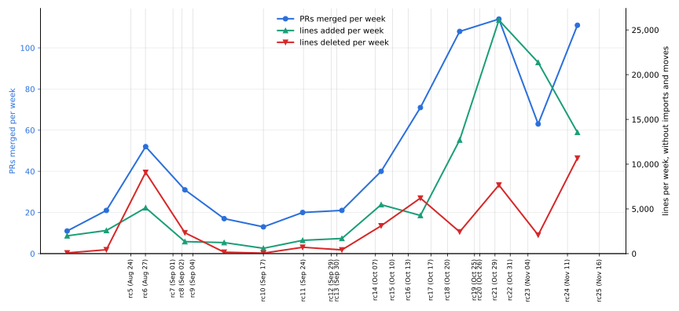

# Amiga GCC Development Manual

Working on the toolchain itself. The
[Amiga GCC User's Manual](manual.md) covers using it.

- [Building](build.md): prerequisites, getting the sources, and building the toolchain.
- [Packaging](package.md): archives of the installed toolchain, and the Nix package.
- [Version management](branches.md): the notable branches, and switching modules to other branches or dates.
- [Testing](testing.md): the testsuites under [volamos](https://github.com/sidick/volamos), which emulates the AmigaOS APIs, their boards and the results.
- [Changes](changes.md): making, reviewing and merging changes.
- [Continuous integration](ci.md): testing pull requests on GitHub Actions.
- [Release engineering](releng.md): making and rebuilding releases.

## Weekly Development Stats

The [data](weekly-devel-stats.json) was extracted by
[scripts/devel-weekly-stats](../scripts/devel-weekly-stats) and graphed by
[scripts/devel-weekly-chart](../scripts/devel-weekly-chart).
